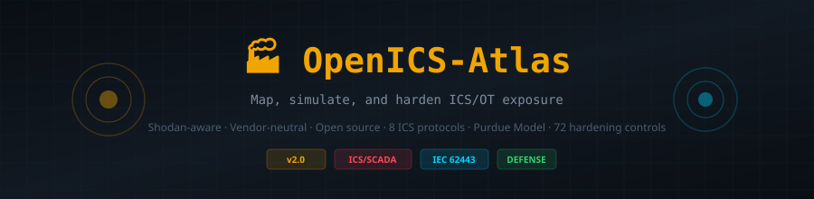

<div align="center">



<br>

[](https://siteq8.github.io/OpenICS-Atlas)
[]()
[](LICENSE)
[]()
[]()
[]()

**Map, simulate, and harden ICS/OT exposure — Shodan-aware, vendor-neutral, open source.**

[Live Demo](https://siteq8.github.io/OpenICS-Atlas) · [Quick Start](#-quick-start) · [Protocols](#-protocols) · [Hardening](#-hardening-checklists) · [Contributing](#-contributing)

</div>

---

## What is OpenICS-Atlas?

OpenICS-Atlas helps **ICS/OT security defenders** visualize internet-exposed industrial control systems, understand the Purdue Model architecture, and generate practical hardening checklists aligned to IEC 62443, NIST SP 800-82, and NERC CIP.

It runs **entirely offline** with synthetic demo data — or connects to the **Shodan API** (aggregated counts only, no host details) for real exposure data.

### Who is this for?

- **OT Security Engineers** — visualize your exposure landscape
- **ICS/SCADA Analysts** — protocol-specific risk guidance and mitigations
- **Compliance Teams** — IEC 62443 / NIST 800-82 / NERC CIP checklists
- **Security Architects** — Purdue Model reference with zone segmentation
- **Penetration Testers** — understand ICS attack surface (defensive use only)

---

## ✨ v2.0 Features

### 📡 Interactive Exposure Map
- World heatmap powered by **Leaflet.js** with dark SCADA-style tile layer
- Circle markers sized by exposure count, colored by risk severity
- Click any marker for country-specific protocol exposure popup
- Country risk table sorted by severity

### ⚡ 8 ICS/SCADA Protocols
Full reference for each protocol including port, risk level, description, affected vendors, known CVEs, and specific mitigations:

| Protocol | Port | Risk | Used In |
|----------|------|------|---------|
| **Modbus/TCP** | 502 | 🔴 Critical | PLCs, RTUs, SCADA (energy, water, manufacturing) |
| **DNP3** | 20000 | 🔴 Critical | Electric utilities, water systems |
| **IEC 60870-5-104** | 2404 | 🟠 High | European/Asian power grids, substations |
| **MMS / IEC 61850** | 102 | 🟠 High | Electrical substations (GOOSE, SV) |
| **EtherNet/IP** | 44818 | 🟠 High | Manufacturing (Rockwell/Allen-Bradley) |
| **OPC UA** | 4840 | 🟡 Medium | Industrial interoperability (secure-by-design) |
| **BACnet/IP** | 47808 | 🟡 Medium | Building automation (HVAC, fire, access) |
| **S7comm/S7comm+** | 102 | 🔴 Critical | Siemens S7 PLCs (300/400/1200/1500) |

### 🏗️ Interactive Purdue Model
- Visual diagram of all 7 Purdue levels (L0–L5 + DMZ)
- Risk percentage per level with color coding
- Technologies and components at each level
- Bar chart showing risk distribution
- Firewall/DMZ indicators between zones

### 🛡️ Hardening Checklists — 72 Controls
Interactive checklists with progress tracking, aligned to industry standards:

| Checklist | Controls | Standard |
|-----------|----------|----------|
| Network Segmentation | 12 | IEC 62443-3-3 |
| PLC/RTU Hardening | 12 | NIST 800-82 |
| Remote Access | 12 | NERC CIP-005 |
| Monitoring & Detection | 12 | MITRE ATT&CK for ICS |
| Patch Management | 12 | IEC 62443-2-3 |
| Incident Response | 12 | NIST SP 800-61 |

### 📊 Protocol Distribution Charts
- **Doughnut chart** — global exposure distribution across all 8 protocols
- **Bar chart** — Purdue level risk assessment
- **Country table** — top 15 countries ranked by exposure with risk badges

### 🌙 Industrial SCADA Aesthetic
- Dark control room theme with scanline overlay
- IBM Plex Mono + IBM Plex Sans typography
- Amber/cyan/red/green color system matching real HMI displays
- Responsive design for desktop, tablet, and mobile

---

## 🚀 Quick Start

### Option 1: GitHub Pages (No Install)

Visit **[https://siteq8.github.io/OpenICS-Atlas](https://siteq8.github.io/OpenICS-Atlas)** — runs entirely in the browser with demo data.

### Option 2: Local (Static)

```bash
git clone https://github.com/SiteQ8/OpenICS-Atlas.git
cd OpenICS-Atlas
open docs/index.html
```

### Option 3: Next.js Development Server

```bash
git clone https://github.com/SiteQ8/OpenICS-Atlas.git
cd OpenICS-Atlas
npm install
npm run dev
# Open http://localhost:3000
```

### Option 4: With Shodan API (Optional)

Create `.env.local`:
```
SHODAN_API_KEY=YOUR_KEY_HERE
```

The Shodan proxy (`/api/shodan`) returns **only aggregated counts** — no host IPs or banners are ever exposed.

---

## 📁 Repository Structure

```
OpenICS-Atlas/
├── docs/                     # Static GitHub Pages site (v2.0 GUI)
│   ├── index.html            # Complete standalone app
│   └── screenshots/          # README assets
├── app/                      # Next.js UI (map, protocol pages, blueprints)
│   ├── api/shodan/           # Shodan aggregation proxy
│   ├── blueprints/           # Purdue/DMZ visual guides
│   └── protocol/[name]/      # Protocol detail pages
├── blueprints/               # Purdue/DMZ/jump-host diagrams
├── checklists/               # Hardening checklists (Markdown)
├── policies/                 # iptables/nftables templates
├── labs/                     # Offline mini-labs
│   └── modbus_mock/          # Mock Modbus server (Docker)
├── data/demo/                # Synthetic demo data
├── components/               # React components (MapView, etc.)
└── docs/                     # Documentation
```

---

## 📊 Demo Data

All exposure data is **synthetic** and does not represent real-world ICS deployments. The data is structured to demonstrate realistic patterns:

- **30+ countries** with exposure counts per protocol
- **8 protocols** with port, risk, vendor, CVE, and mitigation data
- **7 Purdue levels** with risk assessments
- **72 hardening controls** across 6 categories

---

## ⚠️ Ethics & Safety

OpenICS-Atlas is strictly for **defensive education**.

- The Shodan proxy exposes **only aggregated statistics** — no IPs, banners, or identifying data
- All demo data is **synthetic** — no real deployments are mapped
- Do **not** use this tool to target, scan, or exploit any device
- Follow responsible disclosure practices per your organization's policy
- Comply with all applicable laws and regulations in your jurisdiction

See [docs/ETHICS.md](docs/ETHICS.md) for the full ethics statement.

---

## 📚 Standards Referenced

| Standard | Description |
|----------|-------------|
| **IEC 62443** | Industrial Automation and Control Systems Security |
| **NIST SP 800-82** | Guide to Industrial Control Systems Security |
| **NERC CIP** | Critical Infrastructure Protection (North American power grid) |
| **ISA/IEC 62443-3-3** | System Security Requirements and Security Levels |
| **IEC 62351** | Power Systems Management — Data and Communications Security |
| **MITRE ATT&CK for ICS** | Adversary tactics and techniques for industrial control systems |
| **CISA ICS-CERT** | Industrial Control Systems Cyber Emergency Response Team |

---

## 🤝 Contributing

Contributions welcome — especially:

- 🌐 **More protocols** — PROFINET, HART-IP, Foundation Fieldbus, CC-Link
- 📋 **More checklists** — ISA/IEC 62443-4-2, NIST CSF for OT
- 🗺️ **Improved maps** — GeoJSON country boundaries, choropleth
- 🔬 **Lab environments** — more Docker mock services (DNP3, BACnet)
- 📖 **Documentation** — protocol deep-dives, vendor-specific guides
- 🌍 **Translations** — Arabic, German, French, Spanish, Chinese

See [CONTRIBUTING.md](CONTRIBUTING.md) for guidelines.

---

## 📄 License

Apache License 2.0 — see [LICENSE](LICENSE).

---

<div align="center">
  <sub>🏭 OpenICS-Atlas — For defensive education only</sub><br>
  <sub>Built by <a href="https://github.com/SiteQ8">@SiteQ8</a> — Ali AlEnezi 🇰🇼</sub><br>
  <sub>IEC 62443 · NIST 800-82 · NERC CIP · MITRE ATT&CK for ICS</sub>
</div>
